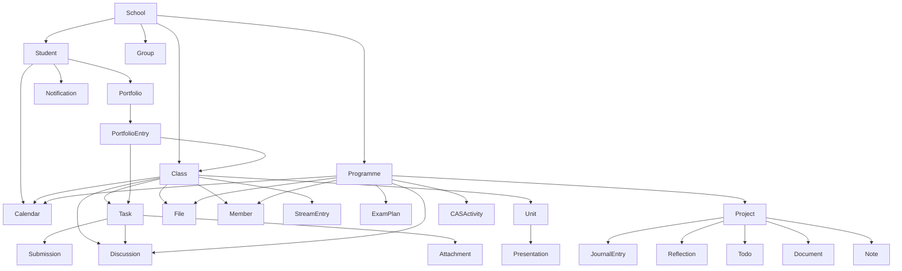

# Architecture and domain model

This document records the student-facing surfaces observed on ManageBac on
2026-09-24. Availability depends on school configuration, programme, region,
and role. An absent feature must not be interpreted as an empty collection.

## Resource graph



Relationships are represented by typed IDs in immutable data objects and by
resource scopes on the client. Data objects remain serializable; network
behavior stays on the client:

```ts
const classes = await client.classes.list();
const course = classes[0];
const tasks = await client.classes.byId(course.id).tasks.listUpcoming();
```

## Observed student features

| Area | Read surfaces observed | Related entities |
| --- | --- | --- |
| Workspace | Home dashboard, configurable widgets, quick add, global search | tasks, events, portfolio entries, projects |
| Account | Profile, profile editing, password, personalization | student, school, programme |
| Notifications | Notification feed and preferences | users and most activity resources |
| Calendar | Personal calendar and event creation | personal, class, and programme events |
| Classes | My/all classes, overview, activity stream | teacher/member, programme |
| Class work | Tasks, task detail, task discussions, units, presentations, orals | class, attachments, submissions, grades |
| Class collaboration | Discussions, files, roster | users, files, comments |
| Class analytics | Assessment chart, grade distribution, task completion | term, task, grade |
| Portfolio | Timeline, evidence, notes, photos, websites, reflections, learning goals | class, task, submission |
| Groups | My/all groups, search, joining | group, membership |
| IB programme | Overview, calendar, discussions, files, members | programme and users |
| Exams planner | Exam plan, personal information, PDF export, exams | subjects and exam sessions |
| Projects | Project overview/edit, journal, presentation, reflections, approval | todos, documents, notes, supervisors |
| CAS | Experiences, aims/goals, documents, notes | reflections, evidence, outcomes |

Routes that create, edit, join, star, submit, upload, or request approval were
discovered but not invoked. Write APIs should eventually live under an
explicit `commands` namespace and require separate opt-in configuration.

## Data correctness rules

1. IDs come from canonical resource URLs, never titles or array positions.
2. `id` is source-native and branded by entity kind at compile time.
3. `key` combines provider, tenant domain, entity kind, and source ID.
4. Every full entity includes `kind`, `source`, `id`, `key`, and canonical URL.
5. Relationships use typed IDs and summaries rather than duplicating full
   nested entities.
6. Collection snapshots include source URL, fetch time, parser version, and a
   completeness guarantee.
7. Duplicate keys with identical records collapse; conflicting records throw.
8. Empty collections are valid only after page identity is independently
   verified.
9. Localized labels are preserved as labels. Normalized enums are added only
   when structural evidence exists; unknown values remain explicit.
10. Ambiguous labels are never converted into invented timestamps. Task due
    timestamps are joined from authoritative calendar events by task and class
    ID, and remain null when no such event exists.
11. “Task” is the canonical entity; “Homework” is a task label, not an identity
    type.

## Layer boundaries

- **Transport:** cookies, redirects, timeouts, safe retries, origin policy.
- **Authentication:** login lifecycle and one bounded session refresh.
- **Acquisition:** pagination, request coalescing, and completeness limits.
- **Parser:** one versioned parser per ManageBac page family.
- **Integrity:** runtime validation, identity construction, deduplication, and
  conflict detection.
- **Resources:** typed, discoverable client graph.
- **DTOs:** immutable and runtime-independent objects suitable for storage.

The transport additionally enforces bounded concurrency and optional spacing
between request starts. Cache entries are parser-versioned and TTL-bound, and
the built-in cache uses bounded LRU eviction. Observability events expose only
request metadata and timings—never headers, bodies, or credentials.

All operational failures cross the public boundary as a `ManageBacError`
subclass with a stable code, explicit retryability, preserved cause, and safe
structured context. Caller cancellation and deadlines remain distinct from
network failure. Parser errors are annotated with the resource, parser version,
and source URL; no error contains response bodies, headers, cookies, or
credentials. Best-effort cache failures are observable without taking down a
scrape, while an explicit cache-clear failure is reported to the caller.

Parsers must not perform network requests, and DTOs must not retain a client or
credentials. This makes fixtures deterministic and keeps storage formats free
of runtime state.

## Expansion order

1. ~~Classes and class-scoped tasks.~~
2. Task submission status/feedback and discussions. Task details, teacher
   attribution, submission state, and assignment attachments are complete;
   submitted-file discovery still needs a source fixture.
3. ~~Calendar events with explicit timezone discovery.~~
4. Grade and assessment data. Class units are complete.
5. Portfolio entries and their task/class links.
6. Programme, exam plan, projects, and CAS.
7. Files, discussions, members, groups, and notifications.

Each resource should ship with fixture tests, a live schema-only integration
test, pagination coverage, and a parser-version change when selectors or
semantics change.
